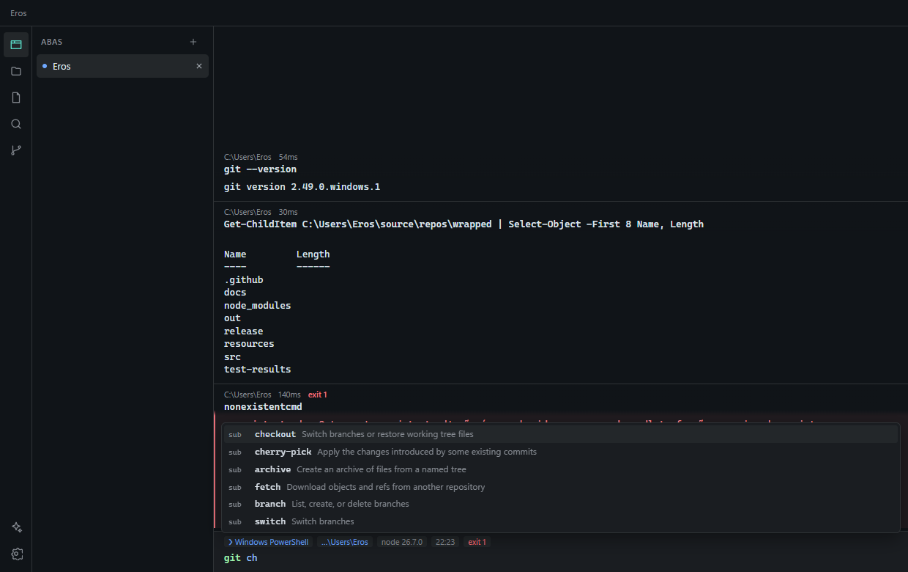

# Wrapped

Terminal moderno para Windows e Linux com blocos de comando, input editor próprio e terminais totalmente personalizáveis.




## Sobre

Inspirado no fluxo de trabalho do [Warp](https://www.warp.dev), mas local: sem conta, sem telemetria e com toda a configuração em arquivos que você pode versionar. É um projeto independente, sem relação com o Warp, e todo o código é original.

### Funcionalidades

**Blocos**
- Cada comando vira um bloco com status, duração, diretório e branch
- Copiar, marcar, recolher, reexecutar, remover, exportar e enviar ao agente
- Filtro por bloco (texto, regex, maiúsculas, linhas de contexto) e busca em todos os blocos
- Cabeçalho fixo em saídas longas, navegação por teclado (`Ctrl+Alt+↑/↓` salta entre blocos marcados) e seleção múltipla
- Saída em background em bloco próprio; programas de tela cheia (`vim`, `less`) ocupam o pane inteiro
- Links e caminhos clicáveis (inclusive `arquivo.ts:42:7`, aberto na linha), seleção inteligente e ocultação automática de secrets

**Input editor**
- Edição multilinha, realce de sintaxe e sublinhado de comandos inválidos
- Autosuggestions do histórico (→ aceita) e completions com specs de centenas de CLIs
- Com o input vazio, sugere o comando que você costuma rodar depois do último, aprendido do histórico
- Command inspector ao passar o mouse, correção de comandos, expansão de aliases e modo Vim
- Input fixo embaixo, em cima ou clássico; prompt em chips ou o do seu shell, com um chip que mostra arquivos e linhas alterados no git

**Terminais personalizados**
- Perfis com shell, argumentos, diretório, variáveis, ícone, cor, tema e comandos de início
- Detecção de PowerShell, Prompt de Comando, Git Bash e distros WSL no Windows; do shell de login, bash, zsh, fish e pwsh no Linux
- Layouts em TOML com panes, comandos e parâmetros
- Temas em YAML, gradiente, imagem de fundo e criação de tema a partir de uma imagem
- Abas verticais ou horizontais, cor por diretório, split panes, maximizar pane (`Ctrl+Shift+Enter`) e sincronização de input
- Atalhos editáveis, hotkey global e janela Quake

**Drive local**
- Workflows com `{{argumentos}}`, notebooks executáveis, prompts e coleções de variáveis de ambiente
- Command palette (`Ctrl+Shift+P`) e busca no histórico (`Ctrl+R`) com status, duração e tempo de cada comando, e filtros por falha e diretório

**Código e agente**
- Explorador de arquivos, busca global, editor, visualizador de Markdown e revisão de diff
- Agent Mode opcional com a sua chave da API Anthropic: pede aprovação antes de executar comandos ou gravar arquivos, e aceita rules e servidores MCP
- `# descrição em linguagem natural` + Enter no input gera o comando para o seu shell, sem executá-lo
- Toolbar com rich input para CLI agents como `claude`

Sync na nuvem, equipes, compartilhamento de sessão e agentes em nuvem ficam de fora: dependem de um backend que este projeto não tem.

### Shells

| Shell | Blocos | Estado |
|---|---|---|
| Windows PowerShell 5.1 | sim | testado |
| Git Bash | sim | testado |
| Bash no WSL | sim | testado |
| Bash no Linux | sim | testado |
| PowerShell 7 | sim | usa o mesmo script, não testado |
| zsh e fish | sim | integração escrita, não testada |
| Prompt de Comando | não | modo clássico |

A integração preserva o `PROMPT_COMMAND` (bash) e os hooks `precmd` (zsh) que você já usa, como os do mise, direnv e starship. O histórico do bash, zsh, fish e PowerShell é importado na primeira execução.

Conexões `ssh` rodam dentro de um bloco comum, sem blocos para os comandos remotos.

## Pré-requisitos

- Windows 10 1809 ou superior, ou Linux com X11 ou Wayland
- Para desenvolver: Node.js LTS e Git; no Linux também Python 3, make e um compilador C++ (para o `node-pty`)

## Instalação e execução

Gere o instalador em `release/`:

```powershell
npm ci
node node_modules/electron/install.js
npm run dist
```

Para desenvolver:

```powershell
npm run dev
```

O instalador não é assinado, então o Windows SmartScreen pode exibir um aviso.

No Linux, o `node-pty` não tem binários pré-compilados e precisa ser compilado para o Electron uma vez:

```bash
npm ci
node node_modules/electron/install.js
npm run rebuild:pty
npm run dev          # ou npm run dist:linux para gerar AppImage, .deb e pacote do pacman
```

## Configuração

Tudo fica em `~/.wrapped/` e é recarregado ao salvar:

| Caminho | Conteúdo |
|---|---|
| `settings.toml` | Configurações |
| `keybindings.yaml` | Atalhos: `palette: ctrl-shift-L` |
| `profiles/*.toml` | Perfis de terminal |
| `tab_configs/*.toml` | Layouts de abas |
| `themes/*.yaml` | Temas |
| `workflows/*.yaml`, `prompts/*.yaml`, `env/*.yaml` | Drive |
| `notebooks/*.md` | Notebooks |
| `rules.md`, `mcp.json`, `agent_profiles/*.yaml` | Agente |

As features abaixo podem ser desligadas na tela de configurações (`Ctrl+,`) ou no `settings.toml`:

| Chave | Padrão | O que faz |
|---|---|---|
| `input.nextCommandSuggestions` | `true` | Sugere o próximo comando com o input vazio |
| `agent.commandGeneration` | `true` | `# descrição` gera um comando; desligado, a linha vai ao shell como comentário |
| `appearance.promptChips` | `["cwd", "git", "diff", "venv", "node", "time"]` | Chips do prompt; tire `diff` para esconder o resumo de alterações do git |
| `terminal.fileLinks` | `true` | Caminhos de arquivo clicáveis na saída (URLs sempre são) |
| `terminal.importShellHistory` | `true` | Importa o histórico do bash, zsh, fish e PowerShell |

Os atalhos novos (`maximize-pane`, `bookmark-previous`, `bookmark-next`) seguem o `keybindings.yaml`, como os demais.

Exemplo de perfil em `~/.wrapped/profiles/projeto.toml`:

```toml
name = "Projeto"
command = "powershell.exe"
kind = "powershell"
cwd = "C:\\Users\\voce\\source\\projeto"
theme = "dracula"
color = "#bd93f9"
startup = ["git status"]

[env]
NODE_ENV = "development"
```

Exemplo de layout em `~/.wrapped/tab_configs/dev.toml`:

```toml
name = "Dev"
title = "{{projeto}}"

[[panes]]
id = "root"
split = "horizontal"
children = ["app", "testes"]

[[panes]]
id = "app"
type = "terminal"
directory = "~/source/{{projeto}}"
commands = ["npm run dev"]
is_focused = true

[[panes]]
id = "testes"
type = "terminal"
directory = "~/source/{{projeto}}"

[params.projeto]
default = "wrapped"
```

## Testes

```powershell
npm test           # unitários
npm run build
npm run test:e2e   # end-to-end com shells reais
```

No Linux, `WRAPPED_E2E_HIDDEN=1 npm run test:e2e` roda os testes com as janelas ocultas, sem tomar a tela de quem está usando o desktop.

## Estrutura do projeto

```
resources/shell/   integração com cada shell (marcadores OSC 133)
src/main/          PTY, persistência, completions, git e agente
src/preload/       ponte entre os processos
src/renderer/      interface React, blocos e input editor
src/shared/        lógica pura: router de blocos, parsers, temas e políticas
tests/             testes unitários e end-to-end
```

## Contribuindo

Veja [CONTRIBUTING.md](CONTRIBUTING.md).

## Licença

[MIT](LICENSE)
